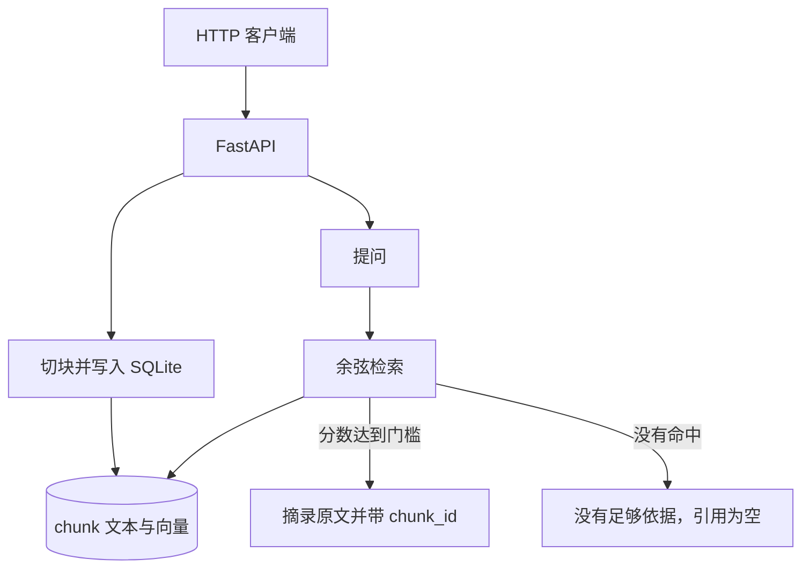

# 带引用的 RAG 问答（P4）

离线向量检索的问答 Agent：文档切块后用多语言句子嵌入做成向量，提问时按余弦相似度取回原文。回答只摘录命中的文本块。没有达到相似度门槛时直接说没有依据，不编造引用。

与工单分流仓库并列。工单项目里的默认知识库仍是关键词匹配。工单仓库设置 `RAG_BASE_URL=http://127.0.0.1:8001` 后，检索改调本服务的 `POST /ask`。

## 架构



## 快速开始

```bash
python -m venv .venv
# Windows: .venv\Scripts\activate
pip install -e ".[dev]"
pytest
python evals/run_evals.py
uvicorn citation_rag.api.main:app --port 8001
```

入库并提问：

```bash
curl -X POST http://127.0.0.1:8001/documents -H "Content-Type: application/json" -d "{\"doc_id\":\"doc-refund\",\"title\":\"退款政策\",\"body\":\"未使用订阅可在 14 天内退款。政策编号 REF-14。\"}"
curl -X POST http://127.0.0.1:8001/ask -H "Content-Type: application/json" -d "{\"question\":\"几天内可以退款\"}"
```

无关问题会返回 `abstained: true` 和空的 `citations`。

第一次运行会把 `paraphrase-multilingual-MiniLM-L12-v2` 下载到 `.data/models`。之后不联网也能检索。不需要 API Key。

## 这一版明确不做

- 不调用聊天模型。回答是摘录，不是先生成再补引用
- 不把向量检索塞回工单分流仓库
- 语料规模用全量扫描，不做近似最近邻

## 失败模式

| 情况 | 行为 |
|------|------|
| 问题为空，或最高分低于 `min_score` | `abstained=true`，引用为空，回答固定为没有足够依据 |
| 同一 `doc_id` 再次入库 | 删掉旧块再写，避免重复引用 |
| 命中 | 回答里的摘录等于库里的原文，并带上 `chunk_id` |

## 目录

```text
src/citation_rag/    # 切块、向量、SQLite、作答、API
tests/               # 检索、引用约束、HTTP
evals/               # 黄金集门禁
```
